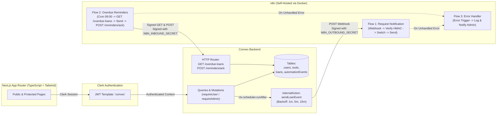

# LendLoop

> *"Borrow what you need. Lend what you don't."*

**LendLoop** is a neighborhood tool-lending platform built for the **Fluence International** technical evaluation. It enables community members to list tools they own, request date-ranged loans, manage approvals and returns, and receive automated notifications and daily overdue reminders powered by **Convex** and **self-hosted n8n** with bidirectional **HMAC-SHA256** request signing.

---

## 1. Overview & Screenshots

| View | Description |
|---|---|
| **Public Landing (`/`)** | Read-only catalog displaying **only** `{ _id, name, category }` with a *"Sign in to lend or borrow"* CTA powered by Clerk. Owner details are never exposed to unauthenticated visitors. |
| **Browse Tools (`/tools`)** | Authenticated catalog with category filter, calculated real-time availability, **Trusted Lender** badges, and an inline date-range loan request form. |
| **My Listings (`/my/listings`)** | Create, edit, and delete personal tool listings (`power_tools`, `garden`, `kitchen`, `camping`, `other`). |
| **My Requests (`/my/requests`)** | Track outgoing borrow requests, cancel pending requests, and inspect recent n8n automation activity (*"Notification sent …"* / *"Overdue reminder sent …"*). |
| **Incoming Requests (`/incoming`)** | Approve or decline pending requests on owned tools, mark approved loans as returned, and view automation event logs. |
| **Admin Panel (`/admin`)** | Protected both in the UI and in Convex (`requireAdmin`): remove any tool listing, inspect all platform loans, and grant/revoke **Trusted Lender** status. |

---

## 2. Architecture



---

## 3. Local Setup (Step by Step)

### Prerequisites
- **Node.js** 20+ and **npm**
- **Docker** & **Docker Compose** (for self-hosted n8n)
- A **Clerk** account and a **Convex** account

### Step 1: Install Dependencies
```bash
git clone https://github.com/EddieBorbon/lendloop.git
cd lendloop
npm install
```

### Step 2: Configure Clerk
1. Create a new application in the [Clerk Dashboard](https://dashboard.clerk.com/).
2. Navigate to **JWT Templates** &rarr; **New template** &rarr; select **Convex**.
3. Ensure the template name is exactly `convex` and copy the **Issuer** URL (e.g., `https://your-instance.clerk.accounts.dev`).
4. Copy your `NEXT_PUBLIC_CLERK_PUBLISHABLE_KEY` and `CLERK_SECRET_KEY`.

### Step 3: Initialize Convex & Environment Variables
1. Copy `.env.example` to `.env.local`:
   ```bash
   cp .env.example .env.local
   ```
2. Fill in `NEXT_PUBLIC_CLERK_PUBLISHABLE_KEY`, `CLERK_SECRET_KEY`, and `CLERK_JWT_ISSUER_DOMAIN` in `.env.local`.
3. Start Convex in development mode:
   ```bash
   npx convex dev
   ```
   This populates `NEXT_PUBLIC_CONVEX_URL` in `.env.local` and gives you your public HTTP Actions URL (`https://<deployment-name>.convex.site`).
4. Set the backend secrets and admin list in your Convex deployment:
   ```bash
   npx convex env set CLERK_JWT_ISSUER_DOMAIN "https://your-instance.clerk.accounts.dev"
   npx convex env set ADMIN_EMAILS "your-email@example.com"
   npx convex env set N8N_WEBHOOK_URL "http://localhost:5678/webhook/lendloop-loan-event"
   npx convex env set N8N_OUTBOUND_SECRET "generate-a-32-byte-hex-secret-for-outbound"
   npx convex env set N8N_INBOUND_SECRET "generate-a-different-32-byte-hex-secret-for-inbound"
   ```

### Step 4: Becoming an Administrator
Admin privileges are **never** accepted from the client. When a user signs in, `users.store` checks whether their authenticated Clerk email is present in the comma-separated `ADMIN_EMAILS` environment variable in Convex. If matched, their `role` is set to `"admin"`.

### Step 5: Start n8n with Docker & Import Workflows
1. Create `n8n/.env` (which is git-ignored) with the following variables:
   ```env
   N8N_ENCRYPTION_KEY=replace-with-random-32-byte-hex
   N8N_OUTBOUND_SECRET=same-as-convex-N8N_OUTBOUND_SECRET
   N8N_INBOUND_SECRET=same-as-convex-N8N_INBOUND_SECRET
   CONVEX_SITE_URL=https://your-deployment.convex.site
   GENERIC_TIMEZONE=UTC
   ```
2. Launch n8n:
   ```bash
   cd n8n
   docker compose up -d
   ```
3. Open `http://localhost:5678` and import the three workflows from `n8n/workflows/` in this order:
   - `n8n/workflows/error-handler.json` (Flow 3: Centralized Error Handler)
   - `n8n/workflows/request-notification.json` (Flow 1: Loan Event Notification)
   - `n8n/workflows/overdue-reminders.json` (Flow 2: Daily Overdue Loan Reminders)
4. Activate all three workflows. Because `CONVEX_SITE_URL` uses the public `*.convex.site` domain, the n8n container can reach your development Convex deployment directly.

### Step 6: Run the Next.js Application
```bash
npm run dev
```
Visit `http://localhost:3000`.

---

## 4. Environment Variables Reference

| Variable | Where It Lives | Purpose |
|---|---|---|
| `NEXT_PUBLIC_CONVEX_URL` | `.env.local` (Next.js) | Convex client WebSocket URL (`https://*.convex.cloud`). |
| `NEXT_PUBLIC_CLERK_PUBLISHABLE_KEY` | `.env.local` (Next.js) | Clerk frontend publishable key. |
| `CLERK_SECRET_KEY` | `.env.local` (Next.js server) | Clerk backend secret key used by `middleware.ts`. |
| `CLERK_JWT_ISSUER_DOMAIN` | `.env.local` & Convex Env | Issuer domain for validating Clerk `"convex"` JWTs in `convex/auth.config.ts`. |
| `ADMIN_EMAILS` | Convex Env | Comma-separated list of emails granted `role: "admin"` upon `users.store`. |
| `N8N_WEBHOOK_URL` | Convex Env | Target webhook URL in n8n for Flow 1 (`sendLoanEvent`). |
| `N8N_OUTBOUND_SECRET` | Convex Env & `n8n/.env` | HMAC-SHA256 secret used by Convex to sign outbound webhooks and by n8n to verify them. |
| `N8N_INBOUND_SECRET` | Convex Env & `n8n/.env` | HMAC-SHA256 secret used by n8n to sign requests to Convex HTTP endpoints and by Convex to verify them. |
| `CONVEX_SITE_URL` | `n8n/.env` (Docker) | Public Convex HTTP Actions URL (`https://*.convex.site`) called by n8n Flow 2. |
| `N8N_ENCRYPTION_KEY` | `n8n/.env` (Docker) | Persistent encryption key for n8n's internal credential store. |
| `NODE_FUNCTION_ALLOW_BUILTIN` | `n8n/docker-compose.yml` | Set to `crypto` so n8n Code nodes can compute and verify HMAC-SHA256 signatures. |
| `GENERIC_TIMEZONE` | `n8n/.env` (Docker) | Timezone used by the daily 09:00 Schedule Trigger in Flow 2. |

---

## 5. Security Decisions

1. **Permissions Enforced in Convex (`convex/lib/auth.ts`)**:
   - Every private query and mutation begins with `requireUser(ctx)` or `requireAdmin(ctx)`.
   - Ownership is verified against `user._id` on the server (`tools.update`, `tools.remove`, `loans.approve`, `loans.decline`, `loans.markReturned`, `loans.cancel`).
   - Admin role assignment (`users.store`) is derived exclusively from `process.env.ADMIN_EMAILS` on the backend.
2. **Bidirectional HMAC-SHA256 with Replay Protection (`convex/lib/hmac.ts`)**:
   - Signature format: `HMAC_SHA256(secret, timestamp + "." + rawBody)` encoded as lowercase hex.
   - Transmitted via `X-LendLoop-Timestamp` (Unix seconds) and `X-LendLoop-Signature`.
   - Receivers reject any request whose timestamp differs from current time by more than **5 minutes (300 seconds)** and compare digests using **constant-time comparison** (`timingSafeEqualHex` in Convex Web Crypto; `crypto.timingSafeEqual` in n8n).
3. **Separate Secrets per Direction**:
   - `N8N_OUTBOUND_SECRET` signs traffic from Convex &rarr; n8n.
   - `N8N_INBOUND_SECRET` signs traffic from n8n &rarr; Convex.
   - Compromising one direction does not allow forging requests in the reverse direction.
4. **Idempotency on All Automation Writes**:
   - `automationEvents` enforces a unique lookup via index `by_key` (`idempotencyKey`).
   - `POST /reminders/ack` uses `overdue:{loanId}:{YYYY-MM-DD}`. If n8n retries an acknowledgement, Convex returns `200 OK` (`{ ok: true, duplicate: true }`) without inserting a duplicate record.
5. **Strict Data Minimization**:
   - **Public Landing (`tools.listPublic`)**: Returns strictly `{ _id, name, category }`. Never returns `ownerId`, owner name, email, condition, or description.
   - **Flow 1 (`sendLoanEvent`)**: Sends only `{ eventId, type, loanId, toolName, recipientEmail, recipientName, startDate, endDate }`.
   - **Flow 2 (`GET /overdue-loans`)**: Returns only `{ loanId, toolName, borrowerEmail, borrowerName, endDate }`.

---

## 6. Reliability & Error Handling

- **Asynchronous Decoupling**: Loan mutations never block on external HTTP calls. They schedule `internal.notifications.sendLoanEvent` via `ctx.scheduler.runAfter(0, ...)`.
- **Exponential Backoff in Convex**: If `sendLoanEvent` fails to reach n8n or receives a non-2xx status, it records `status: "failed"` in `automationEvents` and schedules retries at **1 minute**, **5 minutes**, and **15 minutes** (up to 3 attempts).
- **Node-Level Retries in n8n**: Notification dispatch and HTTP Request nodes in Flow 1 and Flow 2 are configured with `retryOnFail: true` (`maxTries: 3`).
- **Centralized Error Workflow (`n8n/workflows/error-handler.json`)**: Linked via `errorWorkflow: "lendloop-error-handler"` on both Flow 1 and Flow 2. Any unhandled execution failure triggers the `Error Trigger` node, logs structured context (workflow name, failed node, error message, timestamp), and alerts the administrator.

---

## 7. Running Tests & Build Verification

Run the automated test suite (Vitest + `convex-test`) covering permissions, ownership rules, public data minimization, date overlap validation, HMAC-SHA256 verification, and HTTP endpoint idempotency:

```bash
npm test
```

Verify strict TypeScript compilation and production Next.js build:

```bash
npm run typecheck
npm run build
```

